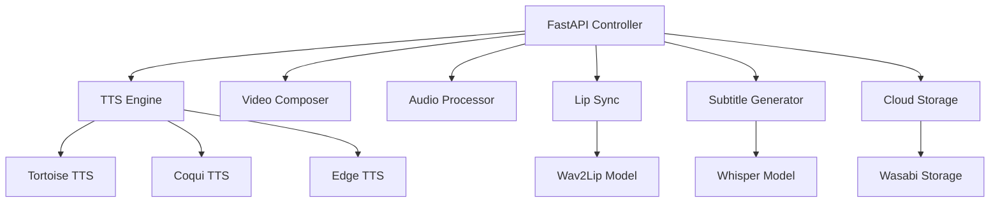

# AI Video Generator - Comprehensive Platform

A complete AI-powered video generation platform with modular architecture, FastAPI backend, and Wasabi cloud storage integration.

## 🚀 Features

### Core Capabilities
- **Text-to-Speech (TTS)** - Multiple engines: Tortoise, Coqui, Edge TTS
- **Lip Sync** - Wav2Lip integration for realistic mouth movements
- **Video Composition** - FFmpeg and MoviePy for professional video editing
- **Audio Processing** - Advanced audio editing and music integration
- **Subtitle Generation** - Whisper-powered transcription and translation
- **Cloud Storage** - Wasabi/S3 compatible storage with automated workflows

### Technology Stack

| Component | Technology |
|-----------|------------|
| **Backend** | FastAPI, Python 3.8+ |
| **TTS Engines** | Tortoise, Coqui, Edge TTS, gTTS |
| **Lip Sync** | Wav2Lip, OpenCV, face_recognition |
| **Video Processing** | FFmpeg, MoviePy, OpenCV |
| **Audio Processing** | PyDub, librosa, scipy |
| **Transcription** | OpenAI Whisper, Faster-Whisper |
| **Cloud Storage** | Wasabi, AWS S3, boto3 |
| **Container** | Docker, Docker Compose |
| **Deployment** | Automated Git to Wasabi workflow |

## 📦 Installation

### Quick Setup (Recommended)

```bash
# Clone the repository
git clone https://github.com/your-username/ai-video-generator.git
cd ai-video-generator

# Run automated setup
chmod +x setup.sh
./setup.sh
```

### Manual Installation

1. **System Dependencies**
```bash
# Ubuntu/Debian
sudo apt-get update
sudo apt-get install -y python3 python3-pip ffmpeg git

# macOS
brew install python@3.9 ffmpeg git
```

2. **Python Environment**
```bash
python3 -m venv venv
source venv/bin/activate
pip install -r requirements_comprehensive_ai_video.txt
```

3. **Configuration**
```bash
cp .env.example .env
# Edit .env with your configuration
```

## 🔧 Configuration

### Environment Variables

Create a `.env` file with the following configuration:

```env
# Wasabi/S3 Cloud Storage
WASABI_ENDPOINT_URL=https://s3.wasabisys.com
WASABI_ACCESS_KEY=your_access_key
WASABI_SECRET_KEY=your_secret_key
WASABI_BUCKET_NAME=your_bucket_name

# OpenAI API (optional)
OPENAI_API_KEY=your_openai_api_key

# Application Settings
APP_ENV=development
APP_DEBUG=true
APP_LOG_LEVEL=INFO
```

### Wasabi Setup

1. **Create Wasabi Account**
   - Sign up at [Wasabi](https://wasabi.com)
   - Create a new bucket
   - Generate access keys

2. **Configure Permissions**
```bash
./configure_wasabi_permissions.py
```

## 🏃‍♂️ Usage

### Start Development Server

```bash
./start_dev.sh
```

### Start Production Server

```bash
./start_server.sh
```

### Using Docker

```bash
docker-compose up -d
```

### API Documentation

Visit `http://localhost:8000/docs` for interactive API documentation.

## 📚 API Reference

### Generate Video

```bash
curl -X POST "http://localhost:8000/generate" \
  -H "Content-Type: application/json" \
  -d '{
    "text": "Hello world! This is a test video.",
    "voice_model": "edge",
    "video_style": "default",
    "add_music": true,
    "add_subtitles": true,
    "resolution": "1920x1080"
  }'
```

### Check Task Status

```bash
curl -X GET "http://localhost:8000/status/{task_id}"
```

### Download Video

```bash
curl -X GET "http://localhost:8000/download/{task_id}"
```

## 🏗️ Architecture

### Modular Design

```
ai-video-generator/
├── modules/
│   ├── tts_engine.py          # Text-to-Speech processing
│   ├── lip_sync.py            # Wav2Lip lip synchronization
│   ├── video_composer.py     # Video composition and editing
│   ├── audio_processor.py    # Audio processing and music
│   ├── subtitle_generator.py # Subtitle generation and translation
│   └── cloud_storage.py      # Wasabi/S3 storage integration
├── fastapi_ai_video_controller.py  # Main FastAPI application
├── git_to_wasabi_workflow.sh      # Automated deployment
└── setup.sh                       # Installation script
```

### Component Interaction



## 🔄 Deployment Workflow

### Git to Wasabi Automation

```bash
# Configure deployment
export WASABI_ACCESS_KEY="your_key"
export WASABI_SECRET_KEY="your_secret"
export WASABI_ENDPOINT_URL="https://s3.wasabisys.com"
export WASABI_BUCKET="your_bucket"

# Run deployment
./git_to_wasabi_workflow.sh
```

### Deployment Steps

1. **Git Pull** - Pulls latest changes
2. **Dependency Installation** - Updates Python packages
3. **Testing** - Runs automated tests
4. **Docker Build** - Creates container images
5. **Package Creation** - Creates deployment package
6. **Wasabi Upload** - Uploads to cloud storage
7. **Production Update** - Updates production environment
8. **Notification** - Sends deployment status

## 🧪 Testing

### Run Tests

```bash
# Activate virtual environment
source venv/bin/activate

# Run all tests
pytest tests/ -v

# Run specific test modules
pytest tests/test_tts.py -v
pytest tests/test_video_composer.py -v
```

### Test Coverage

```bash
pytest --cov=modules tests/
```

## 📊 Monitoring

### Health Check

```bash
curl http://localhost:8000/health
```

### Logs

```bash
# View logs
tail -f logs/app.log

# Docker logs
docker-compose logs -f ai-video-generator
```

### Metrics

- Task completion rates
- Processing times
- Resource usage
- Error rates

## 🔧 Troubleshooting

### Common Issues

1. **FFmpeg Not Found**
```bash
# Ubuntu/Debian
sudo apt-get install ffmpeg

# macOS
brew install ffmpeg
```

2. **CUDA/GPU Issues**
```bash
# Check CUDA availability
python -c "import torch; print(torch.cuda.is_available())"
```

3. **Memory Issues**
```bash
# Increase swap space
sudo fallocate -l 4G /swapfile
sudo chmod 600 /swapfile
sudo mkswap /swapfile
sudo swapon /swapfile
```

4. **Wasabi Connection Issues**
```bash
# Test connection
aws s3 ls s3://your-bucket --endpoint-url https://s3.wasabisys.com
```

### Performance Optimization

1. **GPU Acceleration**
   - Install CUDA toolkit
   - Use GPU-enabled PyTorch
   - Configure TensorRT (optional)

2. **Memory Management**
   - Use streaming for large files
   - Implement file cleanup
   - Monitor memory usage

3. **Caching**
   - Enable TTS caching
   - Cache model downloads
   - Use Redis for session data

## 🤝 Contributing

### Development Setup

```bash
# Fork and clone
git clone https://github.com/your-username/ai-video-generator.git
cd ai-video-generator

# Create feature branch
git checkout -b feature/new-feature

# Install development dependencies
pip install -r requirements-dev.txt

# Run tests
pytest tests/

# Submit pull request
```

### Code Style

- Follow PEP 8
- Use type hints
- Add docstrings
- Write tests for new features

## 📄 License

This project is licensed under the MIT License - see the [LICENSE](LICENSE) file for details.

## 🙏 Acknowledgments

- [OpenAI Whisper](https://github.com/openai/whisper) for speech recognition
- [Wav2Lip](https://github.com/Rudrabha/Wav2Lip) for lip synchronization
- [Tortoise TTS](https://github.com/neonbjb/tortoise-tts) for text-to-speech
- [Coqui TTS](https://github.com/coqui-ai/TTS) for multilingual TTS
- [FastAPI](https://fastapi.tiangolo.com/) for the web framework
- [Wasabi](https://wasabi.com/) for cloud storage

## 📞 Support

### Documentation
- [API Documentation](http://localhost:8000/docs)
- [Technical Guide](TECHNICAL_GUIDE.md)
- [Deployment Guide](DEPLOYMENT_GUIDE.md)

### Community
- [Discord Server](https://discord.gg/your-server)
- [GitHub Discussions](https://github.com/your-username/ai-video-generator/discussions)
- [Stack Overflow](https://stackoverflow.com/questions/tagged/ai-video-generator)

### Enterprise Support
For enterprise support, custom integrations, or commercial licensing, contact us at enterprise@your-domain.com.

---

⭐ **Star us on GitHub** if this project helped you!

🐛 **Found a bug?** Please create an issue on GitHub.

💡 **Have a feature request?** Start a discussion on GitHub.

📧 **Questions?** Join our Discord community.
