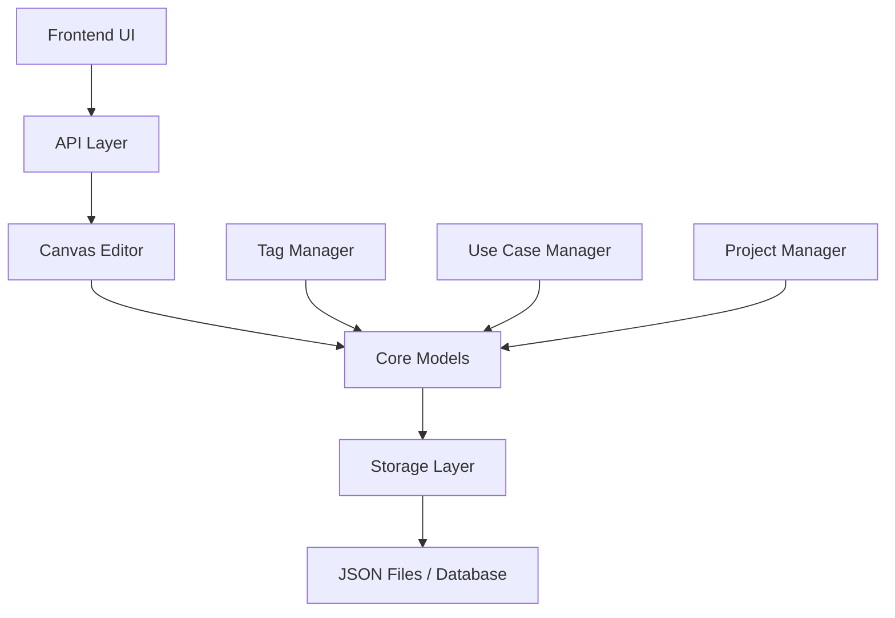

# 🎬 AI Video Generator - Modular Architecture

> A professional, modular video generation platform built with modern web technologies and microservice architecture.

[](https://github.com/your-username/AI-Video-Generator/actions)
[](https://opensource.org/licenses/MIT)
[](https://www.python.org/downloads/)
[](https://nodejs.org/)

## 🌟 Overview

The AI Video Generator is a cutting-edge platform that combines the power of artificial intelligence with intuitive design to create professional videos. Built with a modular architecture, it offers scalability, maintainability, and extensibility for teams of all sizes.

### ✨ Key Features

- 🧩 **Modular Architecture** - Clean separation of concerns with reusable components
- 🎨 **Canvas Editor** - Advanced timeline-based video editing with drag-and-drop
- 🏷️ **Smart Tagging** - Intelligent categorization and organization system
- 📋 **Use Cases** - Pre-built templates and workflows for common scenarios
- ⚛️ **Modern Frontend** - React + Next.js with TypeScript and Tailwind CSS
- 🚀 **Auto Deployment** - CI/CD pipeline with Wasabi cloud integration
- 🔒 **Enterprise Ready** - Authentication, validation, and security built-in

## 🏗️ Architecture

### 📦 Core Components

```
AI-Video-Generator/
├── 🧩 core/                     # Core business logic
│   ├── models.py               # Data models & schemas
│   ├── base.py                 # Abstract base classes
│   └── __init__.py             # Public API
├── 🎨 modular_canvas_editor.py  # Main editor implementation
├── ⚛️ frontend/                 # React frontend
│   ├── app/                    # Next.js app directory
│   ├── components/             # Reusable components
│   └── types/                  # TypeScript definitions
├── 🚀 .github/workflows/        # CI/CD pipelines
└── 📚 docs/                     # Documentation
```

### 🔄 Data Flow



## 🚀 Quick Start

### Prerequisites

- **Python 3.11+** - Backend runtime
- **Node.js 18+** - Frontend development
- **Git** - Version control

### 1️⃣ Clone Repository

```bash
git clone https://github.com/your-username/AI-Video-Generator.git
cd AI-Video-Generator
```

### 2️⃣ Backend Setup

```bash
# Install Python dependencies
pip install -r requirements.txt

# Test core modules
python -c "from core import CanvasProject; print('✅ Core modules loaded')"

# Run modular editor
python modular_canvas_editor.py
```

### 3️⃣ Frontend Setup

```bash
# Navigate to frontend
cd frontend

# Install dependencies
npm install

# Start development server
npm run dev
```

Open [http://localhost:3000](http://localhost:3000) to see the application.

### 4️⃣ Environment Configuration

Copy the environment template:

```bash
cp frontend/.env.local.example frontend/.env.local
```

Configure your environment variables:

```env
# NextAuth.js
NEXTAUTH_URL=http://localhost:3000
NEXTAUTH_SECRET=your-secret-key-here

# OAuth Providers
GOOGLE_CLIENT_ID=your-google-client-id
GOOGLE_CLIENT_SECRET=your-google-client-secret
GITHUB_ID=your-github-client-id
GITHUB_SECRET=your-github-client-secret

# Wasabi/S3 Storage (Optional)
WASABI_ACCESS_KEY=your-wasabi-access-key
WASABI_SECRET_KEY=your-wasabi-secret-key
WASABI_BUCKET=your-bucket-name
WASABI_ENDPOINT=https://s3.wasabisys.com
```

## 🧩 Core Modules

### 📊 Data Models (`core/models.py`)

Essential data structures for the platform:

```python
from core import CanvasProject, CanvasElement, Tag, UseCase

# Create a project
project = CanvasProject(
    id="proj-123",
    name="My Video",
    width=1920,
    height=1080,
    duration=30.0
)

# Add elements
element = CanvasElement(
    id="elem-456",
    type="text",
    x=100, y=100,
    width=400, height=80,
    properties={"text": "Hello World!"}
)

project.add_element(element)
```

### 🎛️ Managers (`core/base.py`)

Powerful management classes for different aspects:

```python
from core import TagManager, ProjectManager, UseCaseManager

# Manage tags
tag_manager = TagManager("storage")
tag = tag_manager.create_tag("Educational", "#4CAF50", "content")

# Manage projects  
project_manager = ProjectManager("storage")
projects = project_manager.list_all()

# Manage use cases
use_case_manager = UseCaseManager("storage")
recommendations = use_case_manager.get_recommended(["Educational"])
```

### 🎨 Canvas Editor

The main editor class that orchestrates everything:

```python
from modular_canvas_editor import ModularCanvasEditor

# Create editor
editor = ModularCanvasEditor()

# Create project from template
project = editor.create_project_from_template("youtube_intro", "My Channel Intro")

# Add elements
title = editor.add_text_element(
    project.id, 
    "Welcome to My Channel!", 
    x=960, y=400, 
    font_size=48
)

# Get analytics
analytics = editor.get_analytics()
print(f"Total projects: {analytics['total_projects']}")
```

## ⚛️ Frontend Components

### 🎯 Key Pages

- **🏠 Home** - Landing page with hero section and features
- **📊 Dashboard** - Project management and analytics
- **🎨 Editor** - Canvas-based video editor interface
- **🏷️ Tags** - Tag management and organization
- **📋 Use Cases** - Template browser and workflows
- **⚙️ Settings** - User preferences and configuration

### 🧱 Component Structure

```typescript
// Example component usage
import { CanvasEditor } from '@/components/CanvasEditor'
import { ProjectList } from '@/components/ProjectList'
import { TagManager } from '@/components/TagManager'

function Dashboard() {
  return (
    <div className="grid grid-cols-12 gap-6">
      <div className="col-span-8">
        <CanvasEditor projectId="current-project" />
      </div>
      <div className="col-span-4">
        <ProjectList />
        <TagManager />
      </div>
    </div>
  )
}
```

## 🚀 Deployment

### 🤖 Automated CI/CD

The project includes a comprehensive CI/CD pipeline:

```yaml
# .github/workflows/modular-ci-cd.yml
name: 🚀 Modular AI Video Generator

on:
  push:
    branches: [ main, develop ]
    tags: [ 'v*' ]

jobs:
  test-core:     # Test core modules
  test-frontend: # Test React components  
  build-package: # Create release package
  deploy-wasabi: # Deploy to cloud storage
  create-release: # GitHub release
```

### 🏷️ Release Management

Use the Git workflow manager for easy releases:

```bash
# Setup Git workflow
./git_workflow_manager.sh setup

# Create modular commits
./git_workflow_manager.sh commit-modules

# Create a release
./git_workflow_manager.sh release v1.0.0

# Push to GitHub
./git_workflow_manager.sh push main --tags
```

### ☁️ Wasabi Deployment

Configure Wasabi credentials in GitHub Secrets:

- `WASABI_ACCESS_KEY` - Your Wasabi access key
- `WASABI_SECRET_KEY` - Your Wasabi secret key  
- `WASABI_BUCKET` - Target bucket name
- `WASABI_ENDPOINT` - Wasabi endpoint URL

## 🧪 Testing

### 🔍 Backend Tests

```bash
# Install test dependencies
pip install pytest pytest-cov black flake8

# Run core module tests
python -m pytest core/ -v --cov=core

# Check code formatting
black --check --diff core/

# Lint code
flake8 core/ --count --statistics
```

### ⚛️ Frontend Tests

```bash
cd frontend

# Install dependencies
npm ci

# Run linting
npm run lint

# Type checking
npx tsc --noEmit

# Build test
npm run build
```

### 🔗 Integration Tests

```bash
# Test full workflow
python -c "
from core import CanvasProject, TagManager, create_project_from_template
from modular_canvas_editor import ModularCanvasEditor

# Test project creation
project = create_project_from_template('social_media_post', 'Test')
print(f'✅ Created: {project.name}')

# Test editor
editor = ModularCanvasEditor()
analytics = editor.get_analytics()
print(f'✅ Analytics: {analytics}')
"
```

## 📚 API Reference

### 🎨 Canvas Editor API

#### Project Management

```python
# Create project
project = editor.create_project(
    name="My Video",
    width=1920, 
    height=1080,
    fps=30,
    duration=60.0
)

# Load project
project = editor.load_project("project-id")

# List all projects
projects = editor.list_projects()

# Delete project
editor.delete_project("project-id")
```

#### Element Management

```python
# Add text element
element = editor.add_text_element(
    project_id="proj-123",
    text="Hello World",
    x=100, y=100,
    font_size=24,
    color="#FFFFFF"
)

# Add image element
element = editor.add_element(
    project_id="proj-123",
    element_type="image",
    x=200, y=200,
    width=400, height=300,
    properties={"source": "/path/to/image.jpg"}
)

# Remove element
editor.remove_element("proj-123", "element-id")
```

#### Tag Management

```python
# Create tag
tag = editor.create_tag(
    name="Educational",
    color="#4CAF50", 
    category="content",
    description="Educational content"
)

# Get tags by category
tags = editor.get_tags(category="content")

# Assign tags to project
editor.assign_tags_to_project("proj-123", ["Educational", "Tutorial"])
```

### 📊 Analytics API

```python
# Get platform analytics
analytics = editor.get_analytics()

# Returns:
{
    "total_projects": 42,
    "total_tags": 15,
    "total_use_cases": 8,
    "projects_by_status": {"Draft": 10, "Final": 5},
    "popular_tags": [{"name": "Educational", "count": 8}],
    "recent_activity": [...]
}
```

## 🤝 Contributing

We welcome contributions! Here's how to get started:

### 🔧 Development Setup

1. **Fork** the repository
2. **Clone** your fork: `git clone https://github.com/your-username/AI-Video-Generator.git`
3. **Create** a branch: `git checkout -b feature/amazing-feature`
4. **Install** dependencies: `pip install -r requirements.txt && cd frontend && npm install`
5. **Make** your changes
6. **Test** thoroughly: Run backend and frontend tests
7. **Commit** with clear messages: `git commit -m 'Add amazing feature'`
8. **Push** to your branch: `git push origin feature/amazing-feature`
9. **Create** a Pull Request

### 📝 Code Style

- **Python**: Follow PEP 8, use `black` for formatting
- **TypeScript**: Use ESLint + Prettier configuration
- **Commits**: Use conventional commit format
- **Documentation**: Update README and inline docs

### 🧪 Testing Requirements

- All new features must include tests
- Maintain or improve code coverage
- Ensure all CI checks pass

## 📄 License

This project is licensed under the MIT License - see the [LICENSE](LICENSE) file for details.

## 🙏 Acknowledgments

- **Next.js Team** - For the excellent React framework
- **Tailwind CSS** - For the utility-first CSS framework  
- **Framer Motion** - For smooth animations
- **Wasabi** - For reliable cloud storage
- **GitHub Actions** - For powerful CI/CD capabilities

## 📞 Support

- 📧 **Email**: support@ai-video-generator.com
- 💬 **Discord**: [AI Video Generator Community](https://discord.gg/ai-video-gen)
- 📚 **Documentation**: [docs.ai-video-generator.com](https://docs.ai-video-generator.com)
- 🐛 **Issues**: [GitHub Issues](https://github.com/your-username/AI-Video-Generator/issues)

---

<div align="center">

**🎬 Start creating amazing videos today!**

[📖 Documentation](https://docs.ai-video-generator.com) • [🚀 Demo](https://demo.ai-video-generator.com) • [💬 Community](https://discord.gg/ai-video-gen)

</div>
